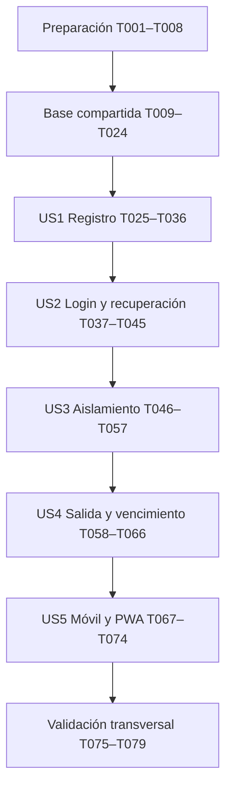

# Tareas: Registro, inicio de sesión y acceso a datos personales

**Entrada**: [spec.md](spec.md), [plan.md](plan.md), [research.md](research.md),
[data-model.md](data-model.md), [contrato API](contracts/auth-api.md),
[enrutamiento local](contracts/development-routing.md) y [quickstart.md](quickstart.md).
**Fecha**: 2026-11-18. Todas las rutas de implementación son relativas a la raíz.
**Estado**: Tareas generadas; ninguna implementación ni prueba se declara terminada.
**Inventario**: 79 tareas: 8 de preparación, 16 de base compartida, 50 de historias
y 5 transversales. 20 tareas admiten trabajo en paralelo bajo sus dependencias.

## Criterios de revisión de cada implementación

Antes de marcar una tarea como terminada, verificar los once principios de la
constitución y las puertas del plan. En cada punto de control registrar qué se
verificó, resultado y limitaciones reales; no sustituir evidencia por marcar casillas.

- Identificadores, SQL, pruebas, comentarios y PHPDoc en inglés; interfaz es-MX y
  documentos Spec Kit en español. Vocabulario consistente: `Payment`, `platformFee`,
  `outstandingBalance`; `clientPaidAmount` no significa dinero neto recibido.
- Nombres legibles y comentarios solo sobre motivos/restricciones; PHPDoc aporta
  información adicional a la firma. Responsabilidad clara y dependencias explícitas.
- Reutilizar la misma regla cuando coincidan responsabilidades y comportamiento;
  mantener independientes cálculos de conceptos distintos. Dominio fuera de handlers
  Mezzio y componentes Astro/React; no introducir abstracciones especulativas.
- Dinero exacto con cadenas/NUMERIC, moneda conservada, sin float ni redondeo implícito.
  Este recorrido MXN admite hasta dos decimales y rechaza precisión adicional.
- Identidad exclusivamente de sesión y autorización backend en cada operación,
  incluyendo agregados y relaciones. Sin caché financiera privada en el navegador.
- Migraciones nuevas y versionadas; una reversión de estructura no equivale a recuperar
  filas. Operaciones destructivas requieren preservación comprobada o deben abortar.

## Formato y ejecución

Cada tarea usa checkbox, ID secuencial, `[P]` opcional, etiqueta de historia cuando
corresponde y rutas concretas. `[P]` permite trabajar sobre archivos independientes
una vez satisfechas sus dependencias; no autoriza ejecutar migraciones o suites
que compartan base simultáneamente. Los archivos de integración comunes
`config/container.php`, `config/routes.php`, `config/pipeline.php` y los lockfiles se
modifican en secuencia. Las pruebas de cada historia se escriben primero y deben
fallar por el comportamiento ausente antes de implementar su solución.

Los nombres de migración enumerados reservan un orden concreto. Si al implementarlas
se generan otros timestamps con Phinx, conservar el orden, registrar sus rutas reales
en este archivo y no renombrar ni editar migraciones ya aplicadas. No crear dos
migraciones para el mismo cambio.

## Fase 1: preparación del proyecto

**Propósito**: Crear el proyecto ejecutable y los entornos local y de pruebas.

- [X] T001 Inicializar PHP 8.4, autoload `FlowBalance\\`, Mezzio 3, PDO, mezzio-session, mezzio-csrf, Phinx y PHPUnit en `composer.json` y `composer.lock`; exigir Argon2id, pdo_pgsql y mbstring, y resolver dependencias compatibles sin instalar Twig.
- [X] T002 [P] Inicializar Astro y TypeScript con integración React compatible, scripts dev/build/test:e2e y versiones bloqueadas en `frontend/package.json`, `frontend/package-lock.json` y `frontend/tsconfig.json`; hidratar solo componentes con interacción justificada.
- [X] T003 [P] Crear `compose.yaml` y `db/bootstrap/01-create-databases.sh` para PostgreSQL 17 UTF-8/C.UTF-8, puerto `127.0.0.1:54329`, volumen persistente y healthcheck; aprovisionar `flow_balance`/`flow_balance_test` y roles exclusivos sin CONNECT cruzado; permitir versionar `compose.yaml` en `.gitignore` conservando secretos fuera de Git.
- [X] T004 [P] Definir variables development/testing, origen público, upstream de API, secretos, credenciales separadas y puertos en `.env.example`; documentar precedencia de variables del proceso sobre archivo local en `docs/configuration.md`, sin valores privados reales ni secretos `PUBLIC_`.
- [ ] T005 Configurar suites Unit/Integration con APP_ENV=testing, scripts Composer, formato/análisis estático y Playwright en `phpunit.xml`, `composer.json` y `frontend/playwright.config.ts`; usar backend/origen de pruebas separados y guardar resultados fuera del código de producto; depende de T001–T004.
- [X] T006 Crear front controller y composición básica Mezzio en `public/index.php`, `config/container.php`, `config/routes.php` y `config/pipeline.php`; enrutar con prefijo `/api` y no ejecutar migraciones en peticiones HTTP; depende de T001.
- [ ] T007 Implementar proxy de desarrollo, APP_ORIGIN/API_PROXY_TARGET, host permitido, puerto estricto y HMR WSS en `frontend/astro.config.mjs`; conservar `/api`, Origin, Cookie y cada Set-Cookie y aplicar no-store a documentos privados desde el servidor; depende de T002 y T006.
- [ ] T008 Documentar y verificar enlace Herd a `public/`, proxy HTTPS a Astro, cabeceras de forwarding saneadas e IP efectiva no falsificable en `docs/local-development.md`; incluir comandos con wrapper y binario PHP explícito de Herd y las dos topologías development/testing; depende de T003–T007.

**Punto de control**: Frontend y `/api` comparten origen HTTPS; el backend de pruebas
no conecta a desarrollo. No iniciar historias hasta completar la fase 2.

## Fase 2: base compartida obligatoria

**Propósito**: Conexión, migraciones, sesión, CSRF e infraestructura de pruebas común.

- [X] T009 [P] Escribir casos de selección de ambiente y guardas de conexión en `tests/Unit/DatabaseConfigTest.php`, rechazando TEST_DB incompleto, nombre/rol incorrectos y fallback a desarrollo; escribir pruebas de política de vencimiento 24 h/7 días y reloj controlable en `tests/Unit/SessionPolicyTest.php`.
- [ ] T010 Implementar configuración/fábrica PDO compartida en `src/Shared/Database/DatabaseConfig.php`, `src/Shared/Database/ConnectionFactory.php` y `config/database.php`; usar variables por ambiente, parámetros preparados y UTC; crear `src/Shared/Clock/Clock.php` y `src/Shared/Clock/SystemClock.php`; satisfacer T009.
- [X] T011 Configurar `phinx.php` reutilizando T010 con `connection`, `name`, `db/migrations`, `phinxlog` y `version_order=execution`; exponer db:create-migration, db:migrate, db:status y db:rollback mediante `@php vendor/bin/phinx` en `composer.json`; rechazar discrepancia APP_ENV/ambiente Phinx.
- [X] T012 Crear primera migración `db/migrations/20261118000100_create_users.php` con id, name, email, password_hash, created_at y updated_at, columna generada `email_normalized` y restricción `users_email_normalized_unique` conforme a data-model.md; up/down explícitos y rechazo de down destructivo con filas sin preservar; depende de T011.
- [X] T013 Crear `db/migrations/20261118000200_create_authentication_state.php` para server_sessions y login_throttles con tipos, FK, índices, timestamps, payload y estados definidos en data-model.md; no almacenar identificadores de sesión en claro ni contraseñas; depende de T012.
- [X] T014 Crear, en este orden, `db/migrations/20261118000300_create_clients.php`, `db/migrations/20261118000400_create_projects.php` y `db/migrations/20261118000500_create_payments.php` para la sección mínima del plan: user_id y relaciones NOT NULL, FK compuestas/RESTRICT, importes NUMERIC y clave de idempotencia única por cuenta; down no pierde filas silenciosamente; depende de T013.
- [ ] T015 Implementar guardas y aislamiento del harness en `tests/bootstrap.php`, `tests/Integration/IntegrationTestCase.php` y `tests/Fixtures/FrozenClock.php`; exigir nombre/rol de base de pruebas, falta de acceso a desarrollo y limpiar fixtures solo allí; no paralelizar suites sobre el mismo esquema; depende de T010–T014.
- [ ] T016 Probar base vacía, migrate repetido sin cambios, historial, rollback/reapply de última migración vacía, nombres/roles separados y aborto de rollback destructivo con filas en `tests/Integration/MigrationLifecycleTest.php`; validar usuarios y normalización por SQL directo, sin depender del registro HTTP posterior; depende de T015.
- [ ] T017 Implementar unidad de trabajo, savepoints y traducción acotada de errores esperados en `src/Shared/Database/UnitOfWork.php`; usar una transacción por petición con commit antes de emitir respuesta y rollback ante excepción; añadir pruebas en `tests/Integration/UnitOfWorkTest.php`; no confirmar transacciones abortadas ni anidar BEGIN.
- [ ] T018 [P] Definir `AuthenticatedUser`, contratos de usuario/hash y la política de sesión en `src/Identity/Domain/AuthenticatedUser.php`, `src/Identity/Domain/UserRepository.php`, `src/Identity/Domain/PasswordHasher.php` y `src/Identity/Domain/SessionPolicy.php`; mantenerlos independientes de Mezzio y satisfacer T009; depende de T010.
- [ ] T019 Implementar el adaptador oficial de persistencia Mezzio en `src/Identity/Infrastructure/PostgresSessionPersistence.php`: identificador aleatorio de 256 bits, solo hash en base, sesión anónima de 15 min, fila bloqueada hasta commit, regeneración con revocación previa y cookie `__Host-flow_balance` HttpOnly/Secure/Lax/Path=/ sin Domain; depende de T013, T017 y T018.
- [ ] T020 Integrar emisión de CSRF y comprobación de Origin/token para escrituras, incluidas las anónimas, en `src/Identity/Http/CsrfTokenHandler.php` y `src/Identity/Http/CsrfProtectionMiddleware.php`; implementar `GET /api/auth/csrf` con mezzio-csrf y sesión antes de CSRF; depende de T019.
- [ ] T021 Implementar identidad y vencimiento privado, tratamiento uniforme 400/401/403/404/415/422/429/503, cuerpo máximo 16 KiB, no-store y saneamiento de proxy en `src/Identity/Http/AuthenticationMiddleware.php`, `src/Shared/Http/ApiResponseMiddleware.php` y `src/Shared/Http/TrustedProxyMiddleware.php`; crear el handler compartido `src/Identity/Http/SessionHandler.php` para `GET /api/auth/session` con usuario/vencimientos y sin renovar inactividad, y registrar orden/factories/ruta en `config/pipeline.php`, `config/container.php` y `config/routes.php`; depende de T017–T020.
- [ ] T022 Crear cliente HTTP de pruebas con cookie jar/CSRF y fixtures básicos de cuentas en `tests/Fixtures/ApiClient.php` y `tests/Fixtures/UserFixture.php`; permitir inyectar reloj y usar el pipeline y el hashing reales; no sustituir autorización con mocks en integración; depende de T015 y T021.
- [ ] T023 Verificar CSRF/origen en escritura anónima, cookie HTTPS, forwarding falsificado, rollback ante indisponibilidad y no-store en errores en `tests/Integration/ApiFoundationTest.php`; comprobar que un error SQL esperado con savepoint permite persistir sesión y devolver el error funcional; depende de T022.
- [ ] T024 Registrar servicios y migraciones de la base común en `config/container.php`, `config/routes.php` y `docs/validation/foundation.md`; ejecutar T009/T016/T017/T023 y guardar comandos/resultados reales, incluida segunda ejecución de migrate sin repeticiones; depende de T023.

**Punto de control**: Persistencia y contratos de seguridad disponibles; base exclusiva
de pruebas verificada. Las tablas financieras básicas sirven a varias historias,
pero no crean un CRUD general ni reglas de comisiones/conversiones.

## Fase 3: US1 - Crear mi cuenta (P1)

**Objetivo**: Registro válido, cuenta única por correo, sesión iniciada y tablero vacío.
**Prueba independiente**: Base migrada sin datos → formulario/registro HTTP → una
cuenta y tablero vacío; variantes de correo y envíos simultáneos no crean duplicados.

### Pruebas de US1

- [ ] T025 [P] [US1] Escribir límites de nombre/correo/contraseña, confirmación exacta, nombres mexicanos, espacios y secreto posterior al byte 72 en `tests/Unit/RegistrationValidationTest.php` y `tests/Unit/NativePasswordHasherTest.php`; cubrir FR-001–FR-005 y H1.2–3/7–8 antes de implementar.
- [ ] T026 [P] [US1] Escribir contrato e integración de registro 201/422, CSRF, cookies nuevas, regeneración, no filtrado de secretos y dos registros concurrentes con correo equivalente en `tests/Integration/RegisterUserTest.php`; comprobar 422 de duplicado sin transacción abortada ni cambios a la cuenta existente; un registro inválido no crea cuenta ni autentica: la sesión anónima de CSRF sigue sin identidad y la API privada responde 401 (H1.1–5/8).
- [ ] T027 [P] [US1] Escribir recorrido de registro y estado inicial en `tests/E2E/registration.spec.ts`, con errores, datos válidos conservados, totales cero, texto “Crear mi primer proyecto” y entrada protegida al flujo (H1.1–8).

### Implementación de US1

- [ ] T028 [US1] Implementar validación y normalización canónica mediante PostgreSQL en `src/Identity/Domain/RegistrationInput.php` y `src/Identity/Infrastructure/PostgresEmailNormalizer.php`; validar longitud Unicode 12–128 sin alterar contraseña y no duplicar el algoritmo SQL de email_normalized; depende de T025.
- [ ] T029 [US1] Implementar inserción/búsqueda de usuario en `src/Identity/Infrastructure/PostgresUserRepository.php`, con savepoint y ROLLBACK TO SAVEPOINT ante el único SQLSTATE/restricción de correo esperados, y fechas UTC; depende de T028 y T026.
- [ ] T030 [US1] Adaptar password_hash(PASSWORD_ARGON2ID), password_verify y password_needs_rehash en `src/Identity/Infrastructure/NativePasswordHasher.php`, exigiendo soporte y sin truncamiento; satisfacer T025 sin cifrado propio.
- [ ] T031 [US1] Implementar `RegisterUser` y `POST /api/auth/register` en `src/Identity/Application/RegisterUser.php` y `src/Identity/Http/RegisterHandler.php`; insertar, regenerar usando el contenedor retornado, rotar CSRF y confirmar antes de 201; registrar factories/ruta en `config/container.php` y `config/routes.php`; depende de T029–T030.
- [ ] T032 [US1] Crear cliente same-origin/CSRF y tipos de error en `frontend/src/lib/api-client.ts` y `frontend/src/lib/auth-types.ts`, sin identidad en localStorage; renovar CSRF después de autenticarse y preservar los mensajes públicos del contrato; depende de T020.
- [X] T033 [US1] Crear formulario/isla acotada y pantalla de registro en `frontend/src/components/RegisterForm.tsx` y `frontend/src/pages/register.astro`; etiquetas/autocomplete correctos, pegado y errores es-MX; registrar con una etapa y redirigir al tablero tras éxito; depende de T031–T032.
- [ ] T034 [US1] Implementar resumen propio y shell de tablero en `src/Finance/Infrastructure/PostgresAccountDataReader.php`, `src/Finance/Application/AccountOverview.php`, `src/Finance/Http/DashboardHandler.php` y `frontend/src/pages/dashboard.astro`; `GET /api/dashboard` filtra toda colección por identidad y para cuenta nueva devuelve vacío/cero, sin hardcodear cuentas existentes; conectar ruta/factories en `config/routes.php` y `config/container.php`.
- [ ] T035 [US1] Implementar guardia inicial de navegación y entrada al primer proyecto en `frontend/src/lib/session-gate.ts` y `frontend/src/pages/projects/new.astro`; mantener contenido privado oculto hasta validar sesión, no-store y enlace “Crear mi primer proyecto”; no simular un CRUD completo que el plan deja al módulo de proyectos; depende de T033–T034.
- [ ] T036 [US1] Ejecutar T025–T027 contra base/origen de pruebas y registrar evidencia de H1.1–8/SC-001 en `docs/validation/registration.md`; verificar independencia de dominio y las cinco convenciones de revisión antes de cerrar US1; depende de T028–T035.

**Punto de control**: Registro verificable y seguro. El enlace abre la entrada al flujo
propio; la creación completa de proyectos conserva la dependencia declarada en spec/plan.

## Fase 4: US2 - Iniciar sesión y recuperar mis datos (P1)

**Objetivo**: Acceso desde web/PWA, errores genéricos, continuidad e intentos limitados.
**Prueba independiente**: Usar cuenta y registros sembrados por fixtures reales; entrar
y recuperar datos. Comprobar límites con reloj controlado y sesiones separadas.

### Pruebas de US2

- [ ] T037 [P] [US2] Escribir ventana móvil 15 min, quinto fallo, pausa 15 min, no extensión, limpieza por éxito y separación por correo/origen en `tests/Unit/LoginThrottleTest.php`; escribir pruebas de errores equivalentes y contraseña exacta en `tests/Unit/LoginUserTest.php` (H2.1/3–5/7–9).
- [ ] T038 [P] [US2] Escribir contrato HTTP y carreras de límite, 401/422/429/Retry-After, correo inexistente, CSRF, regeneración y rehash en `tests/Integration/LoginUserTest.php` y `tests/Integration/LoginThrottleConcurrencyTest.php`; cuatro fallos 401 y quinto 429, con variaciones de mayúsculas/origen.
- [ ] T039 [P] [US2] Escribir recuperación de clientes/proyectos/cobros propios y cero sin cobros propios en `tests/Integration/AccountRecoveryTest.php`, usando filas reales en las tablas migradas; añadir recorrido desde otra sesión en `tests/E2E/login.spec.ts` sin requerir el CRUD de módulos futuros (H2.2/6).

### Implementación de US2

- [ ] T040 [US2] Implementar política y almacenamiento atómico del limitador en `src/Identity/Domain/LoginThrottle.php` y `src/Identity/Infrastructure/PostgresLoginThrottleRepository.php`; HMAC de correo normalizado/IP efectiva, bloqueo de fila, expiración de marcas en límite inferior y sin distinción de existencia; depende de T037–T038.
- [ ] T041 [US2] Implementar `src/Identity/Application/LoginUser.php` con hash ficticio equivalente para correo inexistente, verificación real, rehash tras éxito, limpieza de contador y regeneración de sesión; no restablecer pausa por contraseña correcta; depende de T040 y T029–T030.
- [ ] T042 [US2] Implementar `POST /api/auth/login` en `src/Identity/Http/LoginHandler.php` y reutilizar `GET /api/auth/session`/`src/Identity/Http/SessionHandler.php` de T021; devolver usuario y vencimientos UTC, comprobar con el login real que el estado pasivo no renueva inactividad y cablear `config/routes.php`/`config/container.php`; depende de T041.
- [X] T043 [US2] Crear `frontend/src/components/LoginForm.tsx` y `frontend/src/pages/login.astro` con autocomplete=current-password, errores genéricos, pausa en español y redirección al tablero tras éxito; reutilizar api-client y tipos sin duplicar estado de sesión; depende de T042.
- [ ] T044 [US2] Completar continuidad de acceso y fechas de expiración en `frontend/src/lib/auth-types.ts`, `frontend/src/lib/session-gate.ts` y `frontend/src/pages/dashboard.astro`; soportar reapertura/reingreso sin crear registros nuevos y mostrar datos propios de AccountOverview; no usar polling para mantener sesión; depende de T039 y T043.
- [ ] T045 [US2] Ejecutar pruebas US2 y regresión US1, registrar H2.1–9/SC-002/SC-005 en `docs/validation/login.md`; comparar valores, moneda, fechas y relaciones antes/después de reingreso y verificar ausencia de duplicados; depende de T040–T044.

**Punto de control**: Login y recuperación comprobados sin depender del cierre de
sesión todavía no implementado; las pruebas aíslan los cookie jars para simular reingreso.
El recorrido completo salir/entrar se verifica de nuevo en US4.

## Fase 5: US3 - Trabajar únicamente con mis datos (P1)

**Objetivo**: Proteger registros, relaciones y totales con autorización backend y SQL.
**Prueba independiente**: Ana MXN 3,000.00 y Luis MXN 800.00 en el mismo mes; reportes
propios, lectura/cambio ajenos 404 y cobro de Ana intacto. CSRF válido de Luis para
que un rechazo por CSRF no oculte un defecto de autorización.

### Pruebas de US3

- [ ] T046 [P] [US3] Escribir reglas decimales, rechazo de float/precisión extra y pertenencia explícita en `tests/Unit/ClientPaidAmountTest.php` y `tests/Unit/AccountOwnershipTest.php`; cubrir sumas exactas, periodo mensual y distinción entre importe abonado y recibido neto.
- [ ] T047 [P] [US3] Escribir reporte por cuenta, trazabilidad, filtros/mes sin datos, GET/PATCH ajeno e inexistente, userId manipulado y cambios propios permitidos para clientes/proyectos/cobros en `tests/Integration/AccountIsolationTest.php`; usar los contratos GET/PATCH de clientes/proyectos ya definidos en contracts/auth-api.md, cubrir campos editables, límites de nombre, cuerpos vacíos/desconocidos y relación ajena/inexistente equivalente; usar pipeline real con dos cookies/CSRF y comprobar valor final de Ana (H3.1–8).
- [ ] T048 [P] [US3] Escribir intentos directos SQL de relacionar clientes/proyectos/cobros entre titulares, nulls y rollback completo en `tests/Integration/OwnershipConstraintsTest.php`, sin sustituir restricciones por mocks.
- [ ] T049 [P] [US3] Escribir creación repetida/conflictiva y concurrente de cobro por clave de idempotencia/cuenta en `tests/Integration/PaymentIdempotencyTest.php`; misma clave/contenido devuelve uno, contenido distinto produce conflicto y otra cuenta no comparte la clave.

### Implementación de US3

- [ ] T050 [US3] Implementar importe decimal en `src/Finance/Application/ClientPaidAmount.php` y consultas/modificaciones por `(user_id,id)` en `src/Finance/Infrastructure/PostgresPaymentRepository.php`, `src/Finance/Infrastructure/PostgresClientRepository.php` y `src/Finance/Infrastructure/PostgresProjectRepository.php`; validar cadenas positivas, máximo 14 dígitos enteros y dos decimales, y mantener NUMERIC sin float; depende de T046–T047.
- [ ] T051 [US3] Implementar agregado mensual y detalle trazable en `src/Finance/Infrastructure/PostgresMonthlyReportReader.php` y `src/Finance/Application/MonthlyReport.php`; filtrar cuenta, moneda y `[inicioMes,inicioMesSiguiente)`, devolver clientPaidTotal como cadena y reutilizar reglas de alcance; depende de T050.
- [ ] T052 [US3] Implementar servicios mínimos de datos propios en `src/Finance/Application/CreateClient.php`, `src/Finance/Application/CreateProject.php` y `src/Finance/Application/RecordPayment.php`; exigir AuthenticatedUser, validar relaciones y persistir idempotencia sin crear endpoints generales de CRUD; depende de T048–T050.
- [X] T053 [US3] Crear fixtures de Ana/Luis mediante T052 en `tests/Fixtures/AccountDataFixture.php`, usando esquema de producción y no rutas de backdoor; no permitir reconfigurar el titular por entrada del navegador; depende de T052.
- [ ] T054 [US3] Implementar `GET /api/reports/monthly`, `GET /api/payments/{id}` y `PATCH /api/payments/{id}` en `src/Finance/Http/MonthlyReportHandler.php`, `src/Finance/Http/GetPaymentHandler.php` y `src/Finance/Http/UpdatePaymentHandler.php`; para cubrir H3.1/5 además de los cobros, implementar los contratos mínimos GET/PATCH de clientes/proyectos ya definidos en `specs/001-account-access/contracts/auth-api.md` mediante `src/Finance/Http/GetClientHandler.php`, `src/Finance/Http/UpdateClientHandler.php`, `src/Finance/Http/GetProjectHandler.php` y `src/Finance/Http/UpdateProjectHandler.php` limitando la edición a name y, en proyectos, clientId propio, con validación atómica de campos y relaciones, sin CRUD completo; identidad de sesión, CSRF en PATCH, 404 ajeno/inexistente y rechazo de userId/relaciones ajenas en todos; conectar `config/routes.php`/`config/container.php`; depende de T051–T052.
- [ ] T055 [US3] Integrar reporte/total propio en `src/Finance/Application/AccountOverview.php` y `frontend/src/pages/dashboard.astro`, reutilizando el lector mensual y manteniendo separados importes/monedas; permitir rastrear la cifra hasta cobros propios sin introducir cálculos futuros de saldo/comisiones/conversión; depende de T054.
- [ ] T056 [US3] Escribir y ejecutar recorrido de dos cuentas en `tests/E2E/account-isolation.spec.ts`: totales 3000.00/800.00, petición ajena autenticada/CSRF válido, inexistente equivalente, reconsulta de Ana intacta y cero en otro mes; depende de T053–T055.
- [ ] T057 [US3] Ejecutar T046–T049/T056 y regresión de recuperación US2 con AccountDataFixture; registrar matriz H3.1–8, FR-010–FR-014 y SC-003 en `docs/validation/account-isolation.md`, incluyendo las FK reales y ausencia de cambios parciales; depende de T056.

**Punto de control**: Aceptación técnica de aislamiento acreditada con PostgreSQL,
handlers y servicios reales. Sin extender el alcance a un módulo financiero completo.

## Fase 6: US4 - Cerrar sesión y proteger el acceso posterior (P1)

**Objetivo**: Revocar sesión de servidor y evitar acceso o contenido residual tras salida.
**Prueba independiente**: Cerrar, reutilizar cookie, probar otra pestaña/Atrás/API y
reingresar con otra cuenta; controlar reloj y carreras para vencimiento/revocación.

### Pruebas de US4

- [ ] T058 [P] [US4] Escribir logout/401/403/503, cookie expirada, reintento tras fallo, replay y límites exactos de 24 h/7 días en `tests/Integration/LogoutAndExpiryTest.php`; comprobar otras sesiones independientes vigentes y endpoint de estado que no renueva actividad (H4.1–4/6–9).
- [ ] T059 [P] [US4] Escribir procesos concurrentes para sesión leída antes de logout/regeneración en `tests/Integration/SessionRevocationConcurrencyTest.php`; tras commit no debe persistir ni recrearse la autenticación anterior; verificar orden de locks sin deadlock.
- [ ] T060 [P] [US4] Escribir Atrás/bfcache, otra pestaña, salida sin conexión no confirmada, cambio Ana→Luis y revalidación con temporizador en `tests/E2E/logout-privacy.spec.ts`, sin depender de que llegue BroadcastChannel para negar acceso en servidor.

### Implementación de US4

- [ ] T061 [US4] Implementar revocación y `POST /api/auth/logout` en `src/Identity/Application/LogoutUser.php` y `src/Identity/Http/LogoutHandler.php`; confirmar revocación antes de 204, expirar cookie con atributos originales y tratar reintento ya invalidado sin reactivar; registrar rutas/factories en `config/routes.php` y `config/container.php`; depende de T058–T059.
- [X] T062 [US4] Completar actualización de actividad explícita, límites y cabecera X-Session-Idle-Expires-At en `src/Identity/Http/AuthenticationMiddleware.php` y `src/Identity/Infrastructure/PostgresSessionPersistence.php`; nunca renovar por estado pasivo ni extender 7 días y mantener verificación después del bloqueo; satisfacer T058–T059.
- [X] T063 [US4] Completar limpieza/revalidación en `frontend/src/lib/session-gate.ts` y `frontend/src/lib/private-state.ts`: estado solo en memoria, vencimiento local, pagehide/pageshow/foco/reconexión y BroadcastChannel; ocultar antes de revalidar y sin heartbeat que prolongue sesión; depende de T060 y T062.
- [X] T064 [US4] Crear acción de salida con estado de fallo/reintento en `frontend/src/components/LogoutButton.tsx` e integrarla al tablero `frontend/src/pages/dashboard.astro`; no anunciar éxito sin confirmación, limpiar contenido y dirigir a login al confirmar 204 o sesión ya inválida; depende de T061 y T063.
- [ ] T065 [US4] Aplicar guardia y limpieza común a `frontend/src/pages/projects/new.astro` y toda pantalla privada existente; comprobar no-store en documentos/errores y rechazo API antes de escritura en `tests/Integration/PrivateAccessTest.php`; depende de T062–T064.
- [ ] T066 [US4] Ejecutar pruebas US4 y regresión US1–US3, registrar H4.1–9/FR-015–FR-017/SC-004 en `docs/validation/logout-and-expiry.md`, incluidas concurrencia, datos intactos y sesiones independientes; depende de T065.

**Punto de control**: Salir invalida el servidor; ni cookies previas ni pantallas
retenidas permiten acceder. El cierre completo también verifica la recuperación US2.

## Fase 7: US5 - Usar formularios desde el celular (P2)

**Objetivo**: Formularios de una etapa compatibles con gestores y PWA sin caché privada.
**Prueba independiente**: Registro/login en viewport 360 px, pegado/autocomplete/Enter,
instalación y reapertura PWA; salida/cambio de cuenta/offline sin finanzas guardadas.

### Pruebas de US5

- [ ] T067 [P] [US5] Escribir formularios móviles a 360 px, campos/errores legibles, etiquetas/autocomplete, pegado y Enter en `tests/E2E/mobile-auth.spec.ts`; verificar recorrido de una etapa, sin scroll horizontal ni transcripción manual en los casos automatizables (H5.1–4).
- [ ] T068 [P] [US5] Escribir instalación/reapertura, exclusión de `/api` y rutas privadas del service worker, ausencia de datos financieros en Cache Storage/IndexedDB/localStorage y salida/offline/cambio de cuenta en `tests/E2E/pwa-privacy.spec.ts`; incluir el build servido por HTTPS bajo el mismo origen que /api, registro de /service-worker.js con alcance /, activación y control tras recargar, respuesta JavaScript sin redirección/fallback HTML y exclusiones tras reapertura/pérdida de conexión.

### Implementación de US5

- [ ] T069 [US5] Completar accesibilidad móvil y semántica nativa en `frontend/src/components/RegisterForm.tsx`, `frontend/src/components/LoginForm.tsx` y `frontend/src/layouts/AppLayout.astro`: lang=es-MX, foco/errores asociados, tipos/autocomplete correctos, teclado/gestores sin bloquear pegado y una sola etapa; satisfacer T067 sin duplicar validación de negocio.
- [ ] T070 [US5] Crear manifest, iconos y registro seguro de instalación en `frontend/public/manifest.webmanifest`, `frontend/public/icons/app-192.png`, `frontend/public/icons/app-512.png` y `frontend/src/lib/register-service-worker.ts`; registrar /service-worker.js con alcance /; usar origen HTTPS y acceso compatible desde web/PWA, sin añadir autenticación Astro.
- [ ] T071 [US5] Implementar `frontend/src/service-worker.ts` con lista positiva de assets públicos, bypass NetworkOnly de `/api` y documentos privados y eliminación de caches privadas heredadas al activar; no guardar respuestas por ser GET o por tener estatus 200 y no depender solo de Cache-Control; compilar TypeScript durante el build y emitir /service-worker.js con lista positiva correspondiente a los assets públicos emitidos; depende de T068 y T070.
- [ ] T072 [US5] Integrar manifest/registro SW en `frontend/src/layouts/AppLayout.astro` y política no-store de rutas privadas en `frontend/astro.config.mjs` y `docs/local-development.md`; enlazar con session-gate sin crear almacenamiento financiero persistente y verificar el comportamiento en origen de pruebas y documentar cómo servir el build por HTTPS con /api en el mismo origen, entregando /service-worker.js como JavaScript sin redirección ni fallback HTML; depende de T063 y T069–T071.
- [ ] T073 [US5] Ejecutar comprobación manual de gestor/autocompletado real, instalación/reapertura y usabilidad con cinco participantes según SC-006 en `docs/validation/mobile-usability.md`; registrar navegador/dispositivo y resultados reales, sin presentar atributos HTML o simulación de Playwright como prueba suficiente del gestor ni inventar participantes.
- [ ] T074 [US5] Ejecutar T067–T068 y regresión web/móvil/PWA, guardar evidencia H5.1–4/SC-006–SC-007 en `docs/validation/mobile-auth.md`; comprobar 360 px, modo offline y dos cuentas sin datos residuales; ejecutar también T068 sobre el build, verificando registro, activación, control y ausencia de caché privada tras reapertura y desconexión; depende de T069–T073.

**Punto de control**: P2 indica orden, no opcionalidad. La experiencia móvil y privacidad
PWA forman parte de la aceptación completa.

## Fase 8: validación transversal y entrega

- [ ] T075 Documentar política de migraciones nuevas, rollback de última aplicada, protección de tablas con filas, exportación/restauración y expansión/copia/validación antes de eliminar datos en `docs/migrations.md`; verificar ejemplos Herd/Composer contra los scripts reales, sin confundir schema rollback con recuperación de filas.
- [ ] T076 Revisar las once reglas constitucionales en clases, SQL, handlers, Astro/React y pruebas, y registrar hallazgos/correcciones en `docs/validation/implementation-review.md`; completar logs/métricas sin secretos en `src/Shared/Http/ApiResponseMiddleware.php`, sin abstracciones ni refactorizaciones ajenas al alcance.
- [ ] T077 Ejecutar secuencialmente el conjunto Unit/Integration/E2E y validación desde base vacía de quickstart, incluida segunda migración sin cambios y rollback/reapply de última vacía, registrando versiones/comandos/resultados en `docs/validation/technical-acceptance.md`; usar exclusivamente ambiente de pruebas y no declarar aprobación con pruebas omitidas; depende de T036/T045/T057/T066/T074/T075–T076.
- [ ] T078 Actualizar instrucciones de instalación, routing HTTPS, variables, roles de prueba, comandos y limitaciones reales en `README.md` y `specs/001-account-access/quickstart.md`; mantener explícito el alcance mínimo de proyectos/cobros y corregir cualquier ejemplo que difiera de la implementación; depende de T077.
- [ ] T079 Consolidar trazabilidad FR-001–FR-019, SC-001–SC-007 y tres criterios técnicos en `docs/validation/acceptance-matrix.md`; vincular pruebas/evidencia y registrar cualquier bloqueo o dependencia pendiente, sin dar por completo lo no verificado ni alterar requisitos para hacer pasar el cierre; depende de T078.

## Dependencias y orden de ejecución

### Dependencias de fases e historias

Este es el orden predeterminado de integración. No significa que toda preparación
independiente de una historia deba esperar al cierre de todas las anteriores:

| Historia | Dependencias mínimas | Verificación independiente y dependencias posteriores |
|---|---|---|
| US1 | Base común completa | Cuenta nueva y duplicados; no requiere login ni logout |
| US2 | US1 para repositorio/hash/cliente/shell | Fixtures reales sin CRUD; reingreso entre cookie jars; salida real se revalida en US4 |
| US3 | Identidad y API compartidas de US1/US2 | Fixtures propios, API y SQL reales; reporte/modificación no requieren UI de CRUD |
| US4 | Login y datos de US1–US3 para recorrido completo | Pruebas de revocación pueden escribirse tras base común; UI comparte session-gate |
| US5 | Formularios y ciclo de sesión de US1/US2/US4; datos US3 para privacidad | Pruebas móviles se preparan antes; aceptación PWA requiere el conjunto integrado |

T001 y T002–T004 pueden desarrollarse independientemente; T005 integra sus resultados.
Dentro de la base, T009 y T018 tienen dependencias explícitas y no se ejecutan antes de
ellas. Cada validación de fase espera todas las implementaciones de su historia.
T075 puede redactarse tras la base común; T076–T079 se cierran después de las historias.
Las migraciones se crean y aplican en orden aunque otros archivos puedan escribirse
en paralelo. No paralelizar el harness sobre `flow_balance_test`.

### Paralelismo por historia

Los siguientes pares/grupos trabajan archivos distintos una vez finalizada la base o
la dependencia de historia correspondiente. Son ejemplos de trabajo posible, no una
instrucción de delegación ni de ejecutar suites simultáneamente sobre la misma base.

| Historia | Ejemplo de trabajo paralelo | Barrera de integración |
|---|---|---|
| US1 | T025 validación/hash, T026 integración de registro y T027 E2E | Tests escritos antes de T028–T035; ejecutar en T036 |
| US2 | T037 política, T038 contrato/concurrencia y T039 recuperación | Implementar T040–T044 antes de T045 |
| US3 | T046 importes, T047 API, T048 FK y T049 idempotencia | Integrar T050–T055; ejecutar suites sin competir por esquema |
| US4 | T058 salida/tiempo, T059 carreras y T060 navegación | Integrar T061–T065 antes de T066 |
| US5 | T067 formularios y T068 SW/privacidad | Integrar T069–T072 antes de comprobación manual y cierre |

## Estrategia de implementación

### Primer incremento verificable

Completar preparación, base y US1 para demostrar registro y estado vacío. Esto no
acredita por sí solo el módulo completo: login, aislamiento, salida y experiencia móvil
siguen siendo requisitos. Conservar esas tareas pendientes y sus dependencias visibles.

### MVP funcional del módulo

US1–US4 con los comportamientos móviles obligatorios de US5 y la aceptación técnica
transversal. El CRUD completo financiero y el formulario completo de proyectos siguen
fuera del alcance definido por el plan; su dependencia no se disfraza con pruebas mock.

### Entrega incremental

Ejecutar pruebas de cada historia primero, implementar sus piezas, integrar archivos
compartidos y validar la historia con regresión pertinente antes de continuar. Completar
la matriz final con evidencia real. Si faltan participantes o un entorno compatible
para validaciones manuales, registrar la limitación y conservar la tarea pendiente.
No generar código de otros módulos para cerrar una casilla sin revisar su alcance.

## Cobertura de requisitos y señales de finalización

| Requisito o señal | Tareas principales |
|---|---|
| FR-001–FR-007; H1; SC-001 | T012, T025–T036 |
| FR-008–FR-010; H2; SC-002/SC-005 | T037–T045, T057, T066 |
| FR-011–FR-014; H3; SC-003 | T014, T034, T046–T057 |
| FR-015–FR-017; H4; SC-004 | T019–T023, T058–T066, T068–T074 |
| FR-018–FR-019; H5; SC-006–SC-007 | T033, T043, T067–T074 |
| Base vacía + registro + segunda aplicación sin repetir | T011–T016, T026, T036, T077 |
| Integración real reporte/alteración ajena Ana/Luis | T047–T057, T077 |
| Aplicar, revertir y reaplicar migración reversible | T016, T075, T077 |
| Idioma, comentarios, responsabilidad y reutilización en cada cambio | Criterios de revisión, puntos de control y T076 |

Las casillas solo se marcan al completar el comportamiento y su evidencia. El presente
archivo no ejecuta tareas ni implica que las pruebas descritas ya hayan pasado.
